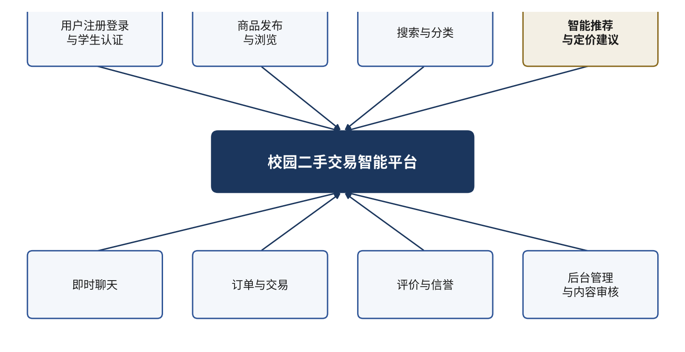
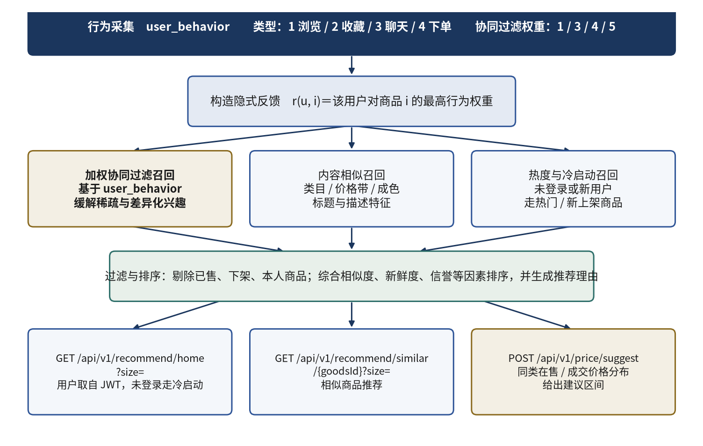
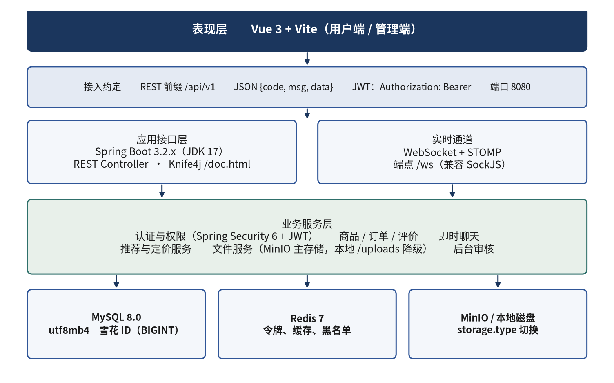

# 基于 Spring Boot 的校园二手交易智能平台

**毕业设计总体方案**

- 文档性质：毕业设计总体方案（开题与总体设计用）
- 配套约定：项目《后端接口规范》v1.0（见 [后端接口规范.md](./后端接口规范.md)）
- 库表脚本：[sql/schema.sql](../sql/schema.sql)
- 编制日期：2026年11月18日

说明：封面中的姓名、学号、学院、专业与指导教师请按所在院校毕业设计模板自行补全。开题、中期检查与答辩的正式时间以学院通知为准。

---

## 目录

- [第1章 选题背景与意义](#第1章-选题背景与意义)
  - [1.1 选题背景](#11-选题背景)
  - [1.2 研究意义](#12-研究意义)
  - [1.3 方案说明](#13-方案说明)
- [第2章 研究目标与研究内容](#第2章-研究目标与研究内容)
  - [2.1 研究目标](#21-研究目标)
  - [2.2 研究内容](#22-研究内容)
  - [2.3 拟解决的关键问题](#23-拟解决的关键问题)
- [第3章 系统需求分析](#第3章-系统需求分析)
  - [3.1 用户角色](#31-用户角色)
  - [3.2 功能需求](#32-功能需求)
  - [3.3 非功能需求](#33-非功能需求)
- [第4章 系统功能模块设计](#第4章-系统功能模块设计)
  - [4.1 总体功能结构](#41-总体功能结构)
  - [4.2 各模块说明](#42-各模块说明)
- [第5章 创新点：面向校园二手场景的智能推荐](#第5章-创新点面向校园二手场景的智能推荐)
  - [5.1 问题分析](#51-问题分析)
  - [5.2 推荐目标与约束](#52-推荐目标与约束)
  - [5.3 统一行为表与隐式反馈](#53-统一行为表与隐式反馈)
  - [5.4 混合推荐流程](#54-混合推荐流程)
  - [5.5 推荐解释与接口呈现](#55-推荐解释与接口呈现)
  - [5.6 辅助能力：同类商品定价建议](#56-辅助能力同类商品定价建议)
  - [5.7 效果评价方案](#57-效果评价方案)
  - [5.8 实现边界](#58-实现边界)
- [第6章 技术选型与系统架构](#第6章-技术选型与系统架构)
  - [6.1 技术选型](#61-技术选型)
  - [6.2 总体架构](#62-总体架构)
  - [6.3 推荐服务的集成方式](#63-推荐服务的集成方式)
- [第7章 数据库设计](#第7章-数据库设计)
  - [7.1 设计约定](#71-设计约定)
  - [7.2 核心数据表](#72-核心数据表)
  - [7.3 user_behavior 表（已确定）](#73-user_behavior-表已确定)
  - [7.4 其他业务表要点](#74-其他业务表要点)
  - [7.5 user_interest 表（已采纳）](#75-user_interest-表已采纳)
- [第8章 接口设计概要](#第8章-接口设计概要)
  - [8.1 基础约定](#81-基础约定)
  - [8.2 认证、聊天与文件](#82-认证聊天与文件)
  - [8.3 智能推荐与定价接口](#83-智能推荐与定价接口)
- [第9章 毕业设计进度安排](#第9章-毕业设计进度安排)
- [第10章 论文章节结构建议](#第10章-论文章节结构建议)
- [结语](#结语)

---

# 第1章 选题背景与意义
## 1.1 选题背景
高等学校学生在就读期间会持续产生教材、数码配件、自行车、日用百货等闲置物品。这类物品具有明显的学期节律：开学、换课、毕业离校时供给和需求都会集中出现。若缺少面向同校场景的交易渠道，闲置资源往往被低价处置或直接丢弃，既不经济，也不环保。

通用二手交易平台虽然覆盖面广，但在校园场景中仍有不足。一是同校匹配效率有限，买卖双方难以优先找到可以当面交割的对象；二是交易双方身份难核实，信任成本较高；三是商品信息过载，学生需要在大量非本校、不同成色和价格的信息中自行筛选。现有一些校园信息发布系统能够完成挂牌与浏览，但对“一物一品、售出即下架、新用户和新商品同时大量出现”的特点考虑不足，也缺少与浏览、收藏、咨询、下单等行为相结合的个性化推荐，以及帮助卖方合理标价的辅助手段。

因此，本毕业设计拟构建一个基于 Spring Boot 的校园二手交易智能平台：在完成学生认证、商品发布、搜索分类、即时聊天、订单交易、信誉评价和后台审核等完整业务闭环的同时，将智能推荐与定价建议作为核心创新点，服务于同校、短周期、非标准化商品的交易决策。

## 1.2 研究意义
从应用上看，平台把交易对象限制在经过认证的在校学生范围内，便于当面交割，有助于降低信任成本和物流成本，提高闲置物品的流转效率。从工程上看，选题覆盖认证与权限、商品与订单、实时通信、文件存储和推荐服务，能够完整训练本科阶段的系统分析、设计、实现与测试能力。

从研究上看，校园二手推荐与常规电商推荐存在本质差异：商品几乎不可重复销售，生命周期短，用户—商品交互高度稀疏，冷启动问题突出。若直接套用“商品会被反复购买”的协同过滤假设，效果往往不稳定。围绕统一行为日志、加权隐式反馈和“协同过滤 + 内容特征 + 冷启动策略”的混合推荐，形成可论证、可实现、可评估的方案，适合作为本科学位论文的主要创新点和论文亮点展开。

## 1.3 方案说明
本文件是毕业设计总体方案，供开题报告撰写、中期检查对照和后续实现使用。接口前缀、统一返回体、分页参数、JWT 约定、STOMP 端点、文件存储方式和主键策略等，与项目《后端接口规范》保持一致。user_behavior 表及推荐、定价相关接口已作为确定设计写入本文。完整库表以 [`sql/schema.sql`](../sql/schema.sql) 为准。除既有业务表外，已采纳 `user_interest`（注册后可选兴趣分类，作为冷启动信号），建表由后端纳入该脚本。

封面信息、指导教师意见以及开题、中期、答辩的正式日期，请按所在院校模板和学院通知补全或替换。方案中的推荐权重、排序因子等属于可实现的设计建议，论文撰写阶段应以系统日志和对比实验加以验证，不将尚未测得的指标预先写为结论。

# 第2章 研究目标与研究内容
## 2.1 研究目标
本毕业设计的目标是：面向高校学生设计并实现一个前后端分离的校园二手交易智能平台，完成从身份认证到成交评价的主要业务流程，并在此基础上实现可解释的个性化推荐与定价建议。具体包括：

• 完成需求分析、总体设计、详细设计、编码实现、测试和部署，形成可演示的系统。

• 以 user_behavior 统一采集浏览、收藏、聊天和下单行为，实现加权协同过滤与内容、热度相补充的混合推荐，作为论文核心创新点。

• 接口、安全与数据约定按《后端接口规范》落地，保证前后端联调一致。

• 按毕业设计工作流程完成开题报告、中期检查材料、学位论文和答辩准备。

## 2.2 研究内容
研究内容分为系统工程与推荐方法两条主线，二者在同一平台中集成：

• 系统工程：角色与用例分析，功能模块划分，技术选型与分层架构，数据库和接口设计，用户认证与学生认证，商品发布与搜索，即时聊天，订单与评价，后台审核，文件存储，以及系统测试。

• 推荐方法：分析二手场景下协同过滤的适用边界，设计行为权重与隐式反馈构造方式，设计多路召回、过滤排序和推荐理由，设计冷启动策略，设计定价建议，并给出可在论文中复现的评价方案。

• 论文工作：整理相关技术与研究现状，独立设置智能推荐章节，完成实验或案例分析和总结展望。

## 2.3 拟解决的关键问题
• 二手商品“一物一品、售出即下架”，以商品为对象的协同过滤稀疏且候选很快失效，需要与内容召回、热度召回配合，并及时过滤已售和下架商品。

• 新用户、新商品同时大量出现，必须为未登录访问和冷启动提供稳定可用的首页推荐，而不能只在“有充足历史”时才给出结果。

• 浏览、收藏、发起聊天和下单对偏好的指示强度不同，需要用统一行为表和明确权重加以区分，并避免为推荐单独再记一套浏览历史而导致数据不一致。

• 推荐结果应当能在界面上给出简要理由，便于说明算法设计，也便于答辩时演示。

# 第3章 系统需求分析
## 3.1 用户角色
系统主要包含以下角色。匿名访客与已登录学生在推荐策略上有所区别，后台管理接口仅对管理员开放。

**表 1** 系统角色与主要能力

| **角色** | **说明** | **主要能力** |
| --- | --- | --- |
| 匿名访客 | 未登录访问者 | 浏览商品列表与详情、查看分类、使用搜索、访问首页热度/冷启动推荐 |
| 学生用户（USER） | 完成注册并按规则完成学生认证的在校用户 | 发布与管理商品、收藏、发起聊天、下单与评价、获取个性化推荐和定价建议 |
| 管理员（ADMIN） | 平台运营与审核人员 | 用户与商品审核、违规处理、分类与公告管理、查看必要的运营数据 |

## 3.2 功能需求
围绕校园二手交易的完整闭环，功能需求归纳如下。

**表 2** 主要功能需求

| **编号** | **需求项** | **要点** |
| --- | --- | --- |
| F1 | 注册登录与认证 | 注册、登录、刷新令牌与退出；学生身份认证；账号状态管理 |
| F2 | 商品发布与浏览 | 多图发布、类目与成色、上架下架、详情展示；商品图最多 9 张 |
| F3 | 搜索与分类 | 按关键词、分类、价格区间等条件检索与筛选 |
| F4 | 智能推荐 | 首页个性化推荐、相似商品推荐；已登录新用户优先按兴趣分类冷启动，未选兴趣或未登录再走热度推荐 |
| F5 | 定价建议 | 发布或改价时，按同类在售/成交分布给出建议价格区间 |
| F6 | 即时聊天 | 基于 STOMP 的在线沟通，支持历史会话与消息分页查询 |
| F7 | 订单与交易 | 下单、状态流转（如预订、完成、取消），禁止购买自己的商品 |
| F8 | 评价与信誉 | 订单完成后互评，形成可展示的信誉信息；已评价不可重复评价 |
| F9 | 后台管理与审核 | 对用户、商品和举报信息进行审核与处理 |

## 3.3 非功能需求
• 安全：采用 Spring Security 6 与 JWT；访问令牌放在 Authorization: Bearer 请求头中；管理员接口 /api/v1/admin/\*\* 仅 ADMIN 可访问。

• 一致性：主键使用雪花 ID，数据库以 BIGINT 存储，接口中序列化为字符串，避免前端 JavaScript 整数精度丢失；金额使用 BigDecimal，保留两位小数。

• 可用性：接口统一返回 {code, msg, data}，成功时 code=200；校验失败、业务失败给出明确 msg 与分段错误码，便于前端处理。

• 可维护：接口文档使用 Knife4j（OpenAPI 3），便于前后端对照；文件存储以 MinIO 为主、本地磁盘降级，降低演示环境对对象存储的强依赖。

• 时区与格式：时间统一为 yyyy-MM-dd HH:mm:ss，时区 Asia/Shanghai；JSON 字段采用 camelCase。

# 第4章 系统功能模块设计
## 4.1 总体功能结构
系统按业务职责划分为八个功能模块。其中“智能推荐与定价建议”是毕业设计的创新模块，也是论文中需要独立成章论述的部分；其余模块构成可运行的交易平台，为推荐提供数据来源和落地场景。总体结构如图 1 所示。



**图 1** 系统功能模块结构

## 4.2 各模块说明
### 4.2.1 用户注册登录与学生认证
提供注册、登录、令牌刷新和退出。登录成功后返回 accessToken、refreshToken、expiresIn 与 userInfo。accessToken 有效期为 2 小时；refreshToken 有效期为 7 天，并写入 Redis。退出时将 accessToken 列入 Redis 黑名单至过期，同时删除 refreshToken。学生认证用于确认用户的在校身份，未通过认证的账号在发布、下单等敏感操作上按业务规则受限。角色区分为 USER 与 ADMIN。注册完成后，用户可选择至多 5 个兴趣分类，也可跳过；该选择写入 user_interest，用于首页冷启动推荐。

### 4.2.2 商品发布与浏览
学生用户可发布二手商品，填写标题、描述、分类、价格、成色等信息，并上传图片。图片仅允许 jpg/jpeg/png/webp，单张不超过 5MB，每个商品最多 9 张。文件先经统一上传接口落盘或写入对象存储，再与商品记录关联。卖家可以编辑、下架自己的商品；访客和登录用户均可查看列表与详情。浏览详情时应写入 user_behavior（behavior_type=1），作为推荐和学习用户兴趣的数据来源，不再单独维护浏览历史表。

### 4.2.3 搜索与分类
系统维护商品分类，支持按关键词、分类、价格区间等条件检索。列表类接口统一使用分页参数 pageNum、pageSize。搜索行为如需保留查询词，可另设搜索记录表；与具体商品的交互一律记入 user_behavior，以免两套日志互相冲突。

### 4.2.4 智能推荐与定价建议
该模块是论文亮点，详细设计见第5章。功能上提供三类能力：首页推荐、相似商品推荐，以及发布或改价时的价格建议。首页推荐从 JWT 中识别当前用户；已登录且已选兴趣分类时优先按兴趣分类冷启动，未选兴趣或未登录再走热度推荐。相似推荐以指定商品为锚点。定价建议依据同类目、相近成色的在售和成交价格分布，给出建议区间。

### 4.2.5 即时聊天
买卖双方可就某一商品在线沟通。实时消息走 WebSocket + STOMP，端点为 /ws，并开启 SockJS 兼容。连接时在 CONNECT 帧中携带 Authorization: Bearer 令牌，由服务端拦截器校验。发送目的地为 /app/chat.send，消息体包含 toUserId、goodsId、content、type（1 文本、2 图片、3 商品卡片）；接收订阅 /user/queue/messages，已读回执订阅 /user/queue/read。会话列表和历史消息通过 HTTP 分页查询。用户就某件商品发起聊天时，写入 user_behavior（behavior_type=3）。

### 4.2.6 订单与交易
校园交易以当面交割为主，系统用订单记录双方达成的意向与履约状态，包括创建、状态变更、取消和完成等。业务上禁止购买自己的商品，并处理商品已被预订等冲突。下单成功后写入 user_behavior（behavior_type=4）。订单状态变更采用子资源形式，例如 PATCH /api/v1/orders/{id}/status。

### 4.2.7 评价与信誉
订单完成后，双方可进行一次评价，重复评价应被拒绝；未完成订单不可评价。评价结果用于展示卖家信誉，并作为推荐排序中的参考因素之一，避免把低信誉卖家的商品长期排在前面。

### 4.2.8 后台管理与内容审核
管理员对用户认证材料、商品信息和用户举报进行审核与处理，维护分类等基础数据。所有 /api/v1/admin/\*\* 接口要求 ADMIN 角色。审核能力是校园平台可信交易的必要组成部分，也便于答辩时说明安全与治理设计。

# 第5章 创新点：面向校园二手场景的智能推荐
智能推荐是本毕业设计的核心创新点和学位论文的主要亮点。本章从问题特性出发，给出统一行为采集、加权隐式反馈、混合召回与排序、推荐解释、定价建议和评价方案，强调方法必须能在真实业务约束下实现，而不是把通用电商推荐模型原样套用到二手商品上。

## 5.1 问题分析
常规电商推荐往往假设同一商品会被多名用户反复浏览和购买，因而用户—商品共现足够支撑物品协同过滤。校园二手交易并不满足这一假设，主要差异如下。

**表 3** 一般电商推荐与校园二手推荐的差异

| **比较维度** | **一般电商推荐** | **校园二手推荐** |
| --- | --- | --- |
| 商品性质 | 标准化 SKU，可反复销售 | 一物一品，售出即下架，生命周期短 |
| 交互密度 | 用户—商品矩阵相对可积累 | 交互高度稀疏，共现关系很快失效 |
| 冷启动 | 以新品或新用户为局部问题 | 开学、毕业季新用户与新商品同时大量出现 |
| 决策因素 | 兴趣、评分、购买习惯为主 | 价格、成色、当面交割便利性和时效同样关键 |
| 推荐目标 | 提高点击与复购 | 提高有效咨询与成交，并控制无效推荐 |

由此可以得到三点结论。第一，不能只做基于物品共现的协同过滤，否则在售商品集合一更新，历史共现就很难再用。第二，必须把浏览、收藏、聊天和下单区分开，因为它们对成交意愿的指示强度明显不同。第三，推荐系统要同时服务未登录访客和新注册用户，首页在没有充分个人历史时也要给出合理结果。这三点构成了本章后续设计的出发点，也可直接作为开题报告和论文中“问题提出”部分的论述提纲。

## 5.2 推荐目标与约束
推荐模块的目标是在可解释、可实现的前提下，提高用户发现合适商品的效率。具体目标包括：

• 为已登录且有行为历史的用户提供个性化首页推荐；已登录但行为很少的新用户，优先依据其在 user_interest 中选择的兴趣分类做冷启动推荐，未选择兴趣分类时再退回热度推荐；未登录用户走热度推荐。

• 在商品详情页提供相似商品推荐，帮助用户在同类、相近价格和成色的在售商品中比较。

• 及时过滤已售、已下架和用户本人发布的商品，避免推荐不可交易对象。

• 为每条推荐提供简要理由，便于用户理解和论文、答辩说明。

约束方面，算法应能够在本科毕业设计周期内实现和验证，以 MySQL 中的行为表和 Redis 缓存为主要支撑，不把尚未论证的大规模深度学习模型作为系统可用的前提。若后续确有余力引入文本向量或图像特征，应放在展望或附加实验中，以免主线范围失控。

## 5.3 统一行为表与隐式反馈
为给协同过滤提供稳定、可加权的数据源，系统用 user_behavior 表统一记录用户与商品的交互，不再单独设立 browse_history 表。浏览历史可按 user_id 与 behavior_type=1 查询得到，避免业务库与推荐日志双写不一致。收藏的“当前是否仍收藏”可由收藏关系表维护；一旦发生收藏、取消收藏以外的行为，仍须向 user_behavior 追加记录。

行为类型与协同过滤权重约定如下。权重取 1、3、4、5，体现“浏览 < 收藏 < 发起聊天 < 下单”的意愿递进：聊天已产生沟通成本，下单则是最强的正反馈。

**表 4** 行为类型与协同过滤权重

| **behavior_type** | **含义** | **写入时机** | **协同过滤权重** |
| --- | --- | --- | --- |
| 1 | 浏览 | 进入商品详情 | 1 |
| 2 | 收藏 | 用户收藏该商品 | 3 |
| 3 | 聊天 | 就该商品发起或有效进入会话 | 4 |
| 4 | 下单 | 成功创建订单 | 5 |

隐式反馈的构造方式建议采用“同一用户对同一商品取最高行为权重”。记 r(u, i) 为用户 u 对商品 i 的反馈强度，则 r(u, i) 等于该用户—商品对上出现过的行为类型所对应权重的最大值。这样，反复刷新详情页不会把浏览权重量加到超过一次下单，语义清楚，也便于在论文中解释。若后续实验表明需要利用浏览频次，可在最高权重之上增加有上限的频次加成，并在消融实验中比较，但不作为第一版的必选项。

表上建立 (user_id, goods_id) 与 (goods_id, behavior_type) 两个索引：前者服务于按用户取历史、构造 r(u, i) 以及“我最近看过”一类查询；后者服务于按商品统计热度、找出与某商品有过交互的用户集合，供物品协同和相似推荐使用。主键 id 与其他业务表一样，采用雪花 ID，类型为 BIGINT。

## 5.4 混合推荐流程
针对协同过滤在二手场景中的稀疏和候选失效问题，本方案采用多路召回、统一过滤再排序的混合流程，处理过程如图 3 所示。



**图 3** 智能推荐与定价处理流程

### 5.4.1 加权协同过滤召回
在由 r(u, i) 构成的隐式反馈矩阵上，实现用户协同与物品协同两类召回，并只保留当前仍可交易的商品。用户协同的思路是：寻找行为模式相近的用户，将其交互过且仍在售的商品作为候选。物品协同的思路是：若若干用户对商品 i 与 j 都产生过加权反馈，则认为二者相近，从而由用户最近交互的商品扩展到相似在售商品。相似度可采用余弦相似度。

需要在论文中如实说明该方法的边界：当某件商品已经售出，它不能再被推荐，但作为“历史锚点”仍可用于发现与之相近的在售商品；若某件在售商品几乎没有交互，协同过滤很难单独召回它，必须依靠内容召回补足。把这一限制写清楚，本身就是本选题区别于套用通用推荐教材之处。

### 5.4.2 内容相似召回
内容召回使用商品自身属性构造相似度，不依赖其他用户是否与该商品发生过交互，因此适合新上架商品。建议使用的特征包括：分类、价格带、成色，以及标题和描述中的关键词或分词结果。相似商品接口即以当前商品的内容向量（或属性组合）为锚点，在同一或相近类目中检索在售商品。价格带相近、成色接近的候选应优先进入召回集合。

### 5.4.3 热度与冷启动召回
冷启动按身份和是否已选兴趣分类分层处理，而不是一律走热度：

- 已登录用户若在 user_interest 中选择了兴趣分类，首页冷启动优先推荐这些分类下的在售商品，推荐理由与兴趣分类对应，例如“根据你选择的兴趣分类”。
- 已登录但未选择兴趣分类（注册时跳过，或之后清空），再退回热度推荐。
- 未登录访客不采集兴趣，直接走热度推荐，与《后端接口规范》中“匿名可访问首页推荐，未登录走热度/冷启动”的约定一致。

热度可按最近一段时间的浏览、收藏、聊天和下单，用与表 4 相同的权重做加权统计，使“被认真咨询或下单”的商品高于仅被大量点击但无人问津的商品。同时应混入一部分新上架商品，避免首页完全被旧的热门物品占据，也给新商品探索流量。兴趣分类最多 5 个，允许跳过，不作为使用系统的前置条件。

### 5.4.4 过滤与排序
三路召回合并后，先过滤已售、已下架和当前用户自己发布的商品，再进行统一排序。排序可先采用可解释的线性加权，便于实现和答辩说明，例如综合协同分数、内容相似度、上架新鲜度和卖家信誉。各因子的具体系数不宜在实现前写成“已证明的最优值”，应在开发后期用小规模对照或网格搜索确定，并在论文中报告比较过程。第一版以稳定、可说明为原则，不为追求复杂模型而牺牲可完成性。

## 5.5 推荐解释与接口呈现
每条推荐附带简短理由，既提升可接受度，也为论文提供案例材料。理由应与实际召回路和特征对应，例如：“根据你选择的兴趣分类”“与你最近浏览的商品同属一类且价格接近”“与当前商品成色和价格相近”“同校最近热门”。不要生成与计算过程不符的理由。

对外接口统一使用 /api/v1 前缀：首页为 GET /api/v1/recommend/home?size=，当前用户从 JWT 解析；已登录且已选兴趣分类时优先按兴趣分类冷启动，未选兴趣或未登录则走热度推荐。相似商品为 GET /api/v1/recommend/similar/{goodsId}?size=。二者均在过滤之后返回在售商品列表及推荐理由。兴趣分类的读写为 PUT /api/v1/users/me/interests 与 GET /api/v1/users/me/interests。接口的返回包络仍为 {code, msg, data}。

## 5.6 辅助能力：同类商品定价建议
二手定价对缺乏经验的学生并不容易，标价过高会长时间无人问询，过低则造成损失。系统提供 POST /api/v1/price/suggest，根据同类目、相近成色的在售价格和已成交价格，给出建议区间，例如用四分位范围描述“常见成交或挂牌区间”，并返回样本数量，避免在样本过少时给出武断结论。

定价建议是推荐主线之外的第二处亮点，方法朴素、好验证，也容易在答辩中演示。它与推荐共用类目、成色和价格等特征，但不替代推荐。请求与响应字段若规范中尚未逐项列明，实现时再在接口文档中补全，并保持统一返回体和 80000–80999 错误码分段。

## 5.7 效果评价方案
论文中应有专门的评价部分，但评价必须基于真实计算或系统运行结果，不能预先填写精确率、召回率等数字。建议从离线指标、对比实验和案例说明三个层次组织。

• 离线指标：以 user_behavior 按时间划分训练集与测试集（时间切分比随机切分更符合“先浏览后成交”的过程），在仍可交易或历史可对照的前提下，计算精确率、召回率、NDCG 或命中率等指标。

• 对比实验：至少比较热度推荐、仅内容推荐、仅加权协同过滤，以及本方案的混合策略；如有余力，再比较“是否使用 1/3/4/5 权重”或“取最高权重还是简单计数”。消融实验能够直接支撑论文创新点。

• 案例说明：选取若干用户或商品，展示召回路径、排序依据和推荐理由，证明方法可解释。答辩演示也可使用同一组案例。

• 在线观察（可选）：若系统在同学范围内试运行，可补充点击、咨询和下单等业务转化情况，作为辅助说明，不作为唯一依据。

若平台上线初期行为数据过少，可先用实现正确性测试保证协同过滤与加权逻辑可复现，再在积累一定日志后补做离线评估。公开的电影评分等数据集与二手交易场景差异较大，不宜作为本选题的主要实验结论来源，至多用于验证程序实现是否正确。

## 5.8 实现边界
为保证毕业设计可按期完成，推荐主线限定为：user_behavior 采集、加权隐式反馈、协同过滤与内容及热度的混合召回、基于 user_interest 的兴趣分类冷启动、过滤排序、推荐理由，以及定价建议。图像识别自动分类、大规模深度推荐模型等可作为“总结与展望”中的后续工作，不作为中期检查的必备完成项。中期检查应至少展示行为采集、一条可用的首页推荐和相似推荐，以及定价建议的基本结果。

# 第6章 技术选型与系统架构
## 6.1 技术选型
技术选型与《后端接口规范》及现有前端工程保持一致，主要版本如下。

**表 5** 技术选型

| **类别** | **选型** | **说明** |
| --- | --- | --- |
| 运行环境 | JDK 17 | 与 Spring Boot 3.x 基线一致 |
| 后端框架 | Spring Boot 3.2.x | 提供 Web、校验、配置与测试支撑 |
| 安全 | Spring Security 6 + JWT（jjwt 0.12） | 无状态认证，access / refresh 分离 |
| 持久层 | MyBatis-Plus 3.5.x | 承担雪花 ID 与基础 CRUD |
| 数据库 | MySQL 8.0，字符集 utf8mb4 | 存储业务数据与行为日志 |
| 缓存 | Redis 7（Spring Data Redis + Lettuce） | 刷新令牌、令牌黑名单、推荐缓存 |
| 即时通讯 | WebSocket + STOMP，端点 /ws | 同时开启 SockJS 兼容 |
| 文件存储 | MinIO 为主，本地磁盘降级 | 由 storage.type 切换，MinIO 不可用时降级到 /uploads |
| 接口文档 | Knife4j（OpenAPI 3） | 访问地址 http://localhost:8080/doc.html |
| 前端 | Vue 3 + Vite | 与当前前端工程 campus-trade-web 保持一致 |

服务端口为 8080，不设置 context-path。选择上述组合，是为了在本科毕业设计中采用当前主流、文档完整且便于答辩说明的技术栈，而不是为技术而堆砌组件。推荐算法在后端服务中实现，必要时用 Redis 缓存首页和相似推荐结果，降低重复计算。

## 6.2 总体架构
系统采用前后端分离的分层架构。浏览器中的 Vue 应用通过 REST 调用 /api/v1 下的业务接口，通过 STOMP 连接 /ws 进行即时聊天。后端在 Spring Security 中完成 JWT 校验和权限控制，再进入各业务服务。数据层由 MySQL、Redis 和文件存储组成，如图 2 所示。



**图 2** 系统总体架构

## 6.3 推荐服务的集成方式
推荐与定价作为后端中的独立服务组件，与商品、订单、聊天等模块解耦：各业务在成功浏览、收藏、发起聊天和创建订单后异步或同步写入 user_behavior，推荐服务依赖行为表、商品表和已采纳的 user_interest 表，不反向侵入订单状态机。首页和相似推荐接口先查缓存，未命中再执行召回与排序。商品被预订、下架或售出后，应失效相关缓存，防止把不可交易商品继续返回给前端。

# 第7章 数据库设计

## 7.1 设计约定

- 主键一律使用 MyBatis-Plus 雪花 ID，数据库以 BIGINT 存储（**不使用自增**），接口 JSON 中序列化为字符串，避免前端 JavaScript 整数精度丢失。
- 时间字段使用 DATETIME，应用层按 `yyyy-MM-dd HH:mm:ss`、时区 Asia/Shanghai 处理。
- 金额使用 DECIMAL(10,2)，与接口中的 BigDecimal、两位小数相对应。
- 字符集为 utf8mb4，排序规则为 utf8mb4_0900_ai_ci（MySQL 8.0）。
- 完整、可执行的建表脚本见 [`sql/schema.sql`](../sql/schema.sql)，与《后端接口规范》v1.0 一并作为实现依据。
- 不再建立 browse_history 表，浏览历史由 `user_behavior` 中 `behavior_type=1` 的记录承担。
- `user_interest` 已采纳，用于记录用户自选的兴趣分类；建表由后端纳入 `schema.sql`，字段与用途以本节为准。

## 7.2 核心数据表

共 15 张业务表，职责如下。

| 表名 | 职责 | 备注 |
| --- | --- | --- |
| sys_role | 角色字典 | USER、ADMIN，与规范第 6 节一致 |
| sys_user | 用户账号、角色、状态、信誉分 | 管理员亦在此表，以 role 区分；登录账号可为用户名/手机号/学号 |
| student_auth | 学生认证材料与审核状态 | POST /users/me/student-verify；后台审核 APPROVE / REJECT |
| category | 商品分类 | 支持 parent_id 树形；接口提供平铺与树两种查询 |
| goods | 商品主信息：标题、价格、成色、交易方式、状态等 | 预订（RESERVED）、售出或下架后不可再被推荐；逻辑删除字段 deleted |
| goods_image | 商品图片地址 | 每件商品最多 9 张 |
| favorite | 当前收藏关系 | 表示“是否仍收藏”；收藏事件同时写入行为表 |
| user_behavior | 浏览/收藏/聊天/下单行为日志 | 已确定，替代 browse_history |
| user_interest | 用户自选兴趣分类 | 已采纳；注册后可选，最多 5 个，可跳过；用于冷启动推荐 |
| trade_order | 订单与状态流转 | 下单后写行为类型 4；不能购买自己的商品 |
| review | 评价与信誉 | 订单完成后双方各评价一次 |
| chat_session | 聊天会话 | 同一商品、同一对用户仅一条会话 |
| chat_message | 历史消息 | type：1 文本 2 图片 3 商品卡片 |
| report | 举报与审核 | 可举报商品或用户，管理员回写 APPROVE / REJECT |
| announcement | 平台公告 | 草稿 / 已发布 / 已下架 |

**表 6** 核心数据表一览

主要状态枚举（与前端 `constants/enums.js` 及接口规范对齐，作为 schema 定稿取值）：

| 对象 | 字段 | 取值 |
| --- | --- | --- |
| 用户角色 | sys_user.role / sys_role.role_code | USER、ADMIN |
| 账号状态 | sys_user.status | NORMAL、BANNED |
| 学生认证 | student_auth.status、sys_user.student_auth_status | PENDING / APPROVED / REJECTED（用户侧另有 NONE） |
| 商品状态 | goods.status | 审核：PENDING_AUDIT、REJECTED；流转：ON_SHELF、RESERVED、SOLD、OFF_SHELF |
| 商品成色 | goods.condition | NEW、LIKE_NEW、GOOD、FAIR、POOR |
| 交易方式 | goods.trade_method | FACE、EXPRESS、EITHER |
| 订单状态 | trade_order.status | PENDING、PAID、COMPLETED、CANCELLED |
| 订单动作 | 接口 action，不落库为独立字段 | PAY、CANCEL、CONFIRM、REFUND（无 DELIVER，不设 deliver_time） |
| 审核结果 | 商品/认证/举报 | APPROVE、REJECT |
| 行为类型 | user_behavior.behavior_type | 1 浏览、2 收藏、3 聊天、4 下单 |
| 聊天消息 | chat_message.type | 1 文本、2 图片、3 商品卡片 |

## 7.3 user_behavior 表（已确定）

user_behavior 是推荐模块的基础表。行为类型为 TINYINT，取值 1、2、3、4 分别表示浏览、收藏、聊天和下单；协同过滤权重为 1 / 3 / 4 / 5。浏览按同一用户同一商品 30 分钟去重（Redis），游客不记录。索引与查询、协同过滤的访问路径一致。

| 字段 | 类型 | 说明 |
| --- | --- | --- |
| id | BIGINT | 雪花主键 |
| user_id | BIGINT | 用户 ID |
| goods_id | BIGINT | 商品 ID |
| behavior_type | TINYINT | 1 浏览，2 收藏，3 聊天，4 下单 |
| create_time | DATETIME | 行为发生时间 |

**表 7** user_behavior 字段定义

```sql
CREATE TABLE user_behavior (
  id             BIGINT   NOT NULL COMMENT '雪花主键',
  user_id        BIGINT   NOT NULL COMMENT '用户ID',
  goods_id       BIGINT   NOT NULL COMMENT '商品ID',
  behavior_type  TINYINT  NOT NULL COMMENT '1浏览 2收藏 3聊天 4下单',
  create_time    DATETIME NOT NULL COMMENT '行为时间',
  PRIMARY KEY (id),
  KEY idx_user_goods (user_id, goods_id),
  KEY idx_goods_type (goods_id, behavior_type)
) ENGINE=InnoDB DEFAULT CHARSET=utf8mb4;
```

完整脚本中还为该表补充了外键、`behavior_type IN (1,2,3,4)` 约束，以及 utf8mb4_0900_ai_ci 排序规则，字段与索引与上表保持一致。

## 7.4 其他业务表要点

下列字段与接口、前端约定对应，详细注释、索引、外键和 CHECK 约束以 [`sql/schema.sql`](../sql/schema.sql) 为准。

- **sys_user**：username、password_hash、nickname、avatar、phone、student_no、school、role、status、credit_score、student_auth_status、last_login_time。username / phone / student_no 均唯一，后两者允许为空。
- **student_auth**：每用户一行（uk_user_id）。含 student_no、real_name、school、card_image_url，以及 status、reason、auditor_id、audit_time。
- **category**：name、parent_id（可空）、sort、status（ENABLED / DISABLED）。
- **goods**：seller_id、category_id、title、description、price、original_price、condition、trade_method、status（PENDING_AUDIT / ON_SHELF / RESERVED / SOLD / OFF_SHELF / REJECTED）、cover_url、view_count、favorite_count、audit_reason、auditor_id、audit_time、deleted。下单后 ON_SHELF→RESERVED，取消或退款回到 ON_SHELF，完成后变为 SOLD。
- **goods_image**：url、name、size、sort_no（1–9），同一商品下 sort_no 唯一。
- **favorite**：user_id、goods_id 唯一，表示当前仍收藏。
- **trade_order**：goods_id、buyer_id、seller_id、price（快照）、remark、status（仅 PENDING / PAID / COMPLETED / CANCELLED）、cancel_reason、pay_time、complete_time；无 DELIVER 状态，也不设 deliver_time。CHECK 保证买家不能等于卖家。
- **review**：order_id + from_user_id 唯一，score 为 1–5 分。
- **chat_session**：initiator_id、peer_id，并用生成列 user_low_id / user_high_id 保证同一商品、同一对用户仅一条会话。
- **chat_message**：session_id、from_user_id、to_user_id、goods_id、content、type、read_flag。
- **report**：reporter_id、target_type（GOODS / USER）、target_id、reason、detail、status、result、auditor_id、audit_time。
- **announcement**：title、content、status（DRAFT / PUBLISHED / OFF_SHELF）、publisher_id、publish_time。
- **user_interest**：id、user_id、category_id、create_time；唯一索引 (user_id, category_id)。每个用户最多 5 条，允许为空（跳过或清空）。建表由后端纳入 schema.sql。
- **sys_role**：预置 USER、ADMIN 两条角色记录。

## 7.5 user_interest 表（已采纳）

注册完成后，系统引导用户选择兴趣分类，作为尚无浏览、收藏等行为时的冷启动信号。用户最多选择 5 个分类，也可以跳过，不阻止后续使用。保存方式为覆盖式：用本次提交的分类列表整体替换该用户已有记录；提交空列表表示清空兴趣分类。建表由后端纳入 [`sql/schema.sql`](../sql/schema.sql)，本方案不改动该脚本。

| 字段 | 类型 | 说明 |
| --- | --- | --- |
| id | BIGINT | 雪花主键 |
| user_id | BIGINT | 用户 ID |
| category_id | BIGINT | 兴趣分类 ID，对应 category.id |
| create_time | DATETIME | 记录创建时间 |

唯一索引为 `(user_id, category_id)`，保证同一用户对同一分类只保留一条记录。每个用户的记录数不超过 5，该上限由接口校验，不在表上再另设计数器字段。

# 第8章 接口设计概要
## 8.1 基础约定
本章与《后端接口规范》保持一致，便于开题材料、详细设计和前后端联调使用同一套约定。服务监听 8080 端口，无 context-path；统一前缀为 /api/v1，按模块划分为 /auth、/users、/goods、/categories、/orders、/reviews、/chat、/files、/admin/\*\*、/recommend、/price。风格为 REST：GET 查询，POST 新增，PUT 全量修改，PATCH 局部修改或状态变更，DELETE 删除；资源名使用复数名词，状态类操作使用子资源。

统一返回体如下，成功时 code=200；失败时 data 为 null，msg 说明原因。

{ "code": 200, "msg": "success", "data": { } }

HTTP 状态码约定：业务成功为 HTTP 200；未登录或令牌失效返回 HTTP 401；无权限返回 HTTP 403；其他业务错误仍返回 HTTP 200，由业务 code 区分。参数校验失败时 code=400，msg 为第一条校验信息。错误码分段为：200 成功；400/401/403/404/500 为通用错误；10000–10999 用户与认证；20000–20999 商品与分类；30000–30999 订单；40000–40999 聊天；50000–50999 评价与信誉；60000–60999 后台管理与审核；70000–70999 文件上传；80000–80999 推荐与价格建议。

分页请求参数为 pageNum（从 1 开始，默认 1）和 pageSize（默认 10，最大 100）。分页结果放在 data 中，包含 records、total、pageNum、pageSize、pages。主键在 JSON 中为字符串；金额为数字，保留两位小数；时间为 yyyy-MM-dd HH:mm:ss。

## 8.2 认证、聊天与文件
认证方面，请求头使用 Authorization: Bearer <accessToken>。登录接口为 POST /api/v1/auth/login，返回 accessToken、refreshToken、expiresIn、userInfo；刷新为 POST /api/v1/auth/refresh；退出为 POST /api/v1/auth/logout。accessToken 有效期 2 小时，refreshToken 有效期 7 天并存储于 Redis。令牌过期或无效时返回 HTTP 401 及 {code:401, msg:"登录已过期"}，前端先尝试刷新，失败再跳转登录。匿名可访问登录、注册、验证码、商品列表与详情、分类、搜索，以及未登录下的首页推荐。登录用户通过 PUT /api/v1/users/me/interests 覆盖保存兴趣分类，请求体为 `{ "categoryIds": [] }`，数组最多 5 个分类 ID，空数组表示清空；通过 GET /api/v1/users/me/interests 查询当前已选兴趣分类。

即时聊天的 STOMP 端点为 /ws（含 SockJS）。CONNECT 帧携带 Authorization: Bearer 令牌。发送目的地 /app/chat.send，消息体为 toUserId、goodsId、content、type；订阅 /user/queue/messages 与 /user/queue/read。历史数据使用 GET /api/v1/chat/sessions 与 GET /api/v1/chat/sessions/{sessionId}/messages?pageNum=&pageSize=。

文件上传为 POST /api/v1/files/upload，使用 multipart/form-data，字段名为 file，返回 url、name、size。仅允许 jpg/jpeg/png/webp，单张不超过 5MB。存储类型由 storage.type=minio|local 切换；MinIO 不可用时自动降级到本地 /uploads，并通过 /files/\*\* 提供静态访问。

## 8.3 智能推荐与定价接口
**表 8** 智能推荐与定价接口

| **方法与路径** | **说明** | **备注** |
| --- | --- | --- |
| PUT /api/v1/users/me/interests | 覆盖保存兴趣分类 | 请求体 `{ "categoryIds": [] }`，最多 5 个，空数组表示清空；需登录 |
| GET /api/v1/users/me/interests | 查询当前兴趣分类 | 需登录 |
| GET /api/v1/recommend/home?size= | 首页推荐 | 用户取自 JWT；已登录且已选兴趣时优先按兴趣分类冷启动，否则走热度推荐 |
| GET /api/v1/recommend/similar/{goodsId}?size= | 相似商品推荐 | 按指定商品召回在售相似商品 |
| POST /api/v1/price/suggest | 定价建议 | 返回建议价格区间；错误码 80000–80999 |

上述接口与推荐模块直接对应，是论文实验和答辩演示的主要入口。size 用于控制返回数量；除规范已写明的查询参数外，定价建议的请求体字段可在实现时于接口文档中补全，但不得改动统一前缀、返回体和错误码分段。

# 第9章 毕业设计进度安排
进度按毕业设计的四个规定节点组织，而不是按一般软件项目的迭代名称来命名。下表时间为结合当前日期（2026年11月18日）和常见本科毕业设计节奏给出的建议安排，便于与开题、中期、论文和答辩对齐；正式截止日期、开题答辩和中期检查的具体日程，必须以所在学院通知为准，并在开题报告中改写成学校要求的表格。

**表 9** 与毕业设计流程对齐的进度安排（建议）

| **阶段** | **建议时间** | **主要工作** | **对应节点** | **阶段成果** |
| --- | --- | --- | --- | --- |
| 第一阶段 | 2026年11月下旬至12月 | 文献调研；需求分析与总体方案；细化推荐与定价设计；撰写并修改开题报告；准备开题答辩 | 开题报告与开题答辩 | 开题报告；文献综述初稿；需求与总体设计；本方案确认稿 |
| 第二阶段 | 2027年1月至3月中旬 | 库表与接口落地；认证、商品、搜索、聊天、订单等核心业务；user_behavior 采集；混合推荐与定价建议第一版；主要页面联调 | 中期检查 | 可演示的核心系统；推荐与定价基本可用；中期检查报告 |
| 第三阶段 | 2027年3月下旬至4月 | 完善审核、评价与异常流程；补充测试；开展推荐对比或案例分析；撰写论文初稿并按指导教师意见修改 | 论文撰写 | 测试说明；实验或案例结果；论文初稿及修改稿 |
| 第四阶段 | 2027年5月 | 论文定稿；整理演示环境与数据；制作答辩演示文稿；预答辩演练并修改薄弱环节 | 答辩准备与毕业答辩 | 论文终稿；答辩 PPT；系统演示与常见问题准备 |

各阶段的检查重点建议如下。开题阶段要能说清“为什么二手场景不能照搬通用电商推荐”，以及 user_behavior 与混合推荐如何解决该问题，避免把开题写成只有功能清单而没有问题意识。中期阶段必须拿出可运行系统，并至少展示首页推荐、相似推荐和定价建议的基本效果，证明创新点已经进入实现，而不是仍停留在设想。论文阶段要把第5章的设计写成完整论述，并补上对比或案例，不能只贴界面截图。答辩阶段应准备：系统演示路径、推荐理由说明、行为权重含义、冷启动策略，以及“为什么不用单一协同过滤”的简短回答。

# 第10章 论文章节结构建议
学位论文建议采用“系统论文 + 创新点独立成章”的结构，将智能推荐从一般功能介绍中抽出，单独作为一章论述，以便评阅教师和答辩委员会直接看到本选题的亮点。以下目录可按所在院校模板调整章名和格式，但建议保留推荐专章，并与前文总体方案相互对应。

**表 10** 学位论文章节结构建议

| **建议章节** | **主要内容** | **与本方案的对应** |
| --- | --- | --- |
| 第1章 绪论 | 研究背景与意义，国内外或同类系统现状，研究内容与方法，论文组织结构 | 对应本方案第1、2章；现状综述需引用正式文献，不能只写感想 |
| 第2章 相关技术与理论基础 | Spring Boot 3、Spring Security 与 JWT、MyBatis-Plus、Redis、WebSocket 与 STOMP、MinIO；推荐算法基础（协同过滤、内容推荐、隐式反馈、冷启动） | 对应第6章技术选型；理论部分为第5章作铺垫，避免把技术说明写成安装手册 |
| 第3章 系统需求分析 | 可行性分析，角色与用例，功能需求与非功能需求，主要流程 | 对应第3章；可用用例图、活动图补充 |
| 第4章 系统总体设计 | 架构设计，功能模块，数据库概念与逻辑结构，接口总体约定，安全与存储方案 | 对应第4、6、7、8章；接口约定与规范保持一致 |
| 第5章 智能推荐设计与实现（亮点章） | 问题分析，user_behavior 与权重设计，混合召回与排序，推荐解释，定价建议，实现要点，实验或案例分析 | 对应本方案第5章；应占足够篇幅，并给出对比或案例，而不是只写“使用了推荐算法” |
| 第6章 系统详细设计与实现 | 认证与权限、商品与搜索、聊天、订单、评价、审核、文件上传等模块的实现与关键界面 | 对应第4章各业务模块；与第5章分工，避免把推荐再重复叙述一遍 |
| 第7章 系统测试 | 测试环境，功能测试，接口与安全测试，推荐相关测试用例，结果分析 | 覆盖主要功能与第5章评价方案中可在系统内验证的部分 |
| 第8章 总结与展望 | 完成的工作、创新点归纳、不足与改进（如更深的文本或图像特征、更细致的排序学习等） | 展望要与第5.8节的实现边界一致，不把未做的工作写成已完成 |

正文之外，按学校模板编排摘要（中英文）、目录、参考文献、致谢和附录。参考文献应包含 Spring 与推荐系统方面的正式资料或学术文献，不能只有网页博客。附录可放置核心表结构、主要接口清单或关键配置说明，与正文互为补充。摘要中建议用一两句话明确写出：针对二手商品生命周期短、交互稀疏和冷启动突出的问题，设计了基于 user_behavior 加权隐式反馈的混合推荐，并提供定价建议。这是评阅时最容易被首先看到的创新表述。

写作时还应注意：不在论文中填写尚未测得的准确率或性能数字；截图应来自实际系统；接口路径、返回体和表字段与实现保持一致；创新章既要有方法说明，也要有实现和评价，防止被看成纯工程堆砌或纯算法空谈。

# 结语
本方案把“基于 Spring Boot 的校园二手交易智能平台”按毕业设计要求整理为可执行的总体设计：在完整交易闭环之上，以智能推荐为论文亮点，用 user_behavior 统一采集浏览、收藏、聊天和下单行为，按 1/3/4/5 的权重构造隐式反馈，并以协同过滤、内容相似，以及“兴趣分类优先、否则热度”的冷启动策略组成混合推荐，同时提供定价建议。技术栈、接口前缀、返回体、分页、JWT、STOMP、文件存储和主键策略均与《后端接口规范》一致。进度按开题报告、中期检查、论文撰写和答辩准备安排，文末给出了论文章节结构建议。

使用本方案时，请将封面信息和学校正式时间表补全后纳入开题报告；实现阶段严格维持接口与 user_behavior 约定；论文阶段把第5章扩展为独立章节并补全评价。若指导教师对推荐方法、演示范围或章节标题有进一步要求，应优先按指导教师意见调整，再同步修改本方案和接口文档，避免三处表述不一致。
