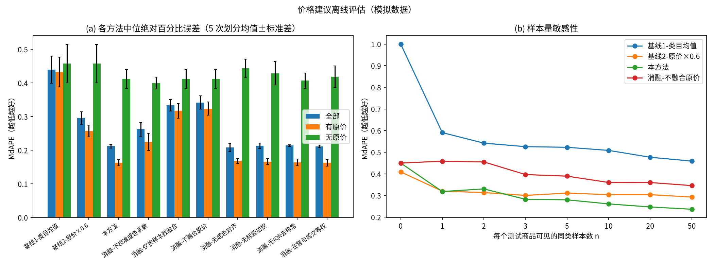

# 价格建议离线实验（⚠️ 模拟数据，论文用，自包含可复现）

本目录是「基于 Spring Boot 的校园二手交易智能平台」价格建议算法（`POST /api/v1/price/suggest`）的离线评估。算法核心 `src/com/campus/trade/price/core/` 与后端 `backend/src/main/java/com/campus/trade/price/core/` 逐字节相同；标题相似度用到的 `recommend/core`（TF-IDF / 中文二元组）也一并复制。实验程序 `PriceExperimentMain.java` 从 `/workspace/smart-module` 复制，在本目录复现的结果与 smart-module 正式结果逐字节一致（已用 cmp 验证）。

> **全部为模拟数据结果**：数据由 `scripts/gen_campus_data.py` 生成（固定种子 20261118），成交价、成色、原价都是按下文规则模拟的，不代表真实平台效果。

## 1. 目录结构

```
experiments/price/
├── README.md / run_all.sh / requirements.txt / .gitignore（忽略 data/、build/）
├── scripts/gen_campus_data.py   模拟数据（与 experiments/recommend 中同一脚本）
├── scripts/plot_price.py        作图
├── src/com/campus/trade/price/core/        算法核心（与后端相同）
├── src/com/campus/trade/recommend/core/    标题相似度依赖（与后端相同）
├── src/com/campus/trade/price/experiment/PriceExperimentMain.java
└── results/
    ├── price_main.csv / price_results.md      报告划分（split seed 42–46）
    ├── price_sample_size.csv                  样本量敏感性
    ├── price_condition_factors.csv            成色系数校准结果
    ├── price_splits.csv                       各划分逐次结果
    ├── validation_seed7/                      验证划分（7–11，选参/确认用）
    ├── archive_v1/                            第一版算法结果（过程存档）
    └── figures/fig4_price_suggest.png
```

## 2. 复现

```bash
cd experiments/price
export JAVA_HOME=~/tools/jdk-17.0.21+9     # 任意 JDK 17
bash run_all.sh
```

环境为 JDK 17（不需要 Maven）和 Python 3（numpy、matplotlib）。本机实测全流程 **25 秒**（2026-11-18）。程序参数为 `数据目录 输出目录 起始划分种子 划分次数`。

## 3. 数据（⚠️ 模拟）

价格字段使用独立随机流 `RandomState(SEED+1)`，在行为生成之后才抽取：

- 原价 $o$ = 分类基准价 × 1.6 × 子主题价位系数（对数正态 σ=0.45）× 对数正态（σ=0.35），约 35% 的商品未填原价。
- 成色 NEW/LIKE_NEW/GOOD/FAIR/POOR 的概率为 0.12/0.28/0.32/0.18/0.10。
- 真实残值 $v=o$ × 真实成色系数（0.88/0.74/0.60/0.46/0.32，故意与系统默认系数不同）× 分类折旧系数 U(0.8,1.1) × 对数正态（σ=0.18）。
- 挂牌价 = $\min(o,\ v\times$ 对数正态(μ=0.08, σ=0.10)$)$，其中 2% 为录入错误（×10 或 ×0.1）。
- 成交价（只有已售商品有）= 挂牌价（无录入错误）× U(0.85,1.0)，其中 2% 为打包价或近乎赠送（×3 或 ×0.15）。

共 5000 件商品，其中已售 1291 件（作为测试来源），3233 件填了原价。

## 4. 算法

记请求成色为 $c_q$，成色系数为 $f(\cdot)$（默认 NEW 1.0 / LIKE_NEW 0.85 / GOOD 0.7 / FAIR 0.55 / POOR 0.4，可配置），样本 $s$ 的价格、成色、原价分别为 $p_s, c_s, o_s$。

**① 成色系数校准**（可选，默认开启）：用同类带原价的样本估计"价格/原价"，向默认系数 $f_0$ 收缩，样本少时不会被个别异常值带偏：

$$
\hat f(c)=\frac{n_c\cdot\operatorname{median}\{p_s/o_s : c_s=c\}+m\,f_0(c)}{n_c+m},\qquad m=10
$$

**② 成色对齐**：把每个样本折算到请求成色 $\tilde p_s=p_s\cdot f(c_q)/f(c_s)$。

**③ 样本权重**：已成交 $w_{sold}=1$，在售 $w_{listed}=0.4$；有标题时按 TF-IDF（中文 bigram）余弦加权：

$$
w_s=w_{type(s)}\cdot\bigl(1+\gamma\cos(\text{title}_q,\text{title}_s)\bigr),\qquad \gamma=2
$$

**④ IQR 去异常**：保留 $\tilde p_s\in[Q_1-1.5\,\text{IQR},\ Q_3+1.5\,\text{IQR}]$（样本 ≥ 4 时）。

**⑤ 样本估计**：加权中位数与加权四分位区间 $m=\text{wQ}_{0.5}(\tilde p, w)$，$[l,h]=[\text{wQ}_{0.25},\text{wQ}_{0.75}]$。

**⑥ 与原价折算融合**（填了原价时）：折算价 $a=o_q\cdot f(c_q)$。两路估计按"可信度"加权：

$$
\lambda=\underbrace{\frac{n}{n+\kappa}}_{\text{样本数}}\cdot\underbrace{\frac{\sigma_a^2}{\sigma_a^2+\sigma_s^2}}_{\text{离散度（逆方差）}},\qquad
P=\lambda m+(1-\lambda)a
$$

其中 $\sigma_s$ 是对齐后样本 $\ln\tilde p$ 的稳健标准差（IQR/1.349），反映同类商品之间的价位差异；$\sigma_a$ 是带原价样本残差 $r_s=\ln\bigl(p_s/(o_s f(c_s))\bigr)$ 的稳健标准差，反映"原价×成色系数"的折算误差。样本不足 4 个时取默认 $\sigma_s=0.6,\ \sigma_a=0.3$；$\kappa=5$。区间同样融合：$[\lambda l+(1-\lambda)a\,e^{Q_1(r)},\ \lambda h+(1-\lambda)a\,e^{Q_3(r)}]$（残差不足 4 个时用 $a(1\pm15\%)$）。样本数 $n<5$ 时 $\lambda<0.5$，即"主要依赖原价折算"，reason 中会注明。

**⑦ 约束与兜底**：$P\le o_q$、$\max\le o_q$、$\min\le P\le\max$；无原价时直接用 $m,[l,h]$；无原价且无样本时返回本分类（为空再看父分类）全部商品价格的中位数，区间 ±15%，reason 说明"建议补充原价"。

reason 示例（按集成测试的数据与代码中的拼接规则）："参考同分类 8 件成交/在售商品（已按成色折算到「轻微使用痕迹」，剔除 1 个异常价），加权中位数 ¥1350.00。"

## 5. 离线评估（⚠️ 模拟数据）

**协议**：已售商品（1291 件，成交价 `deal_price` 模拟 `trade_order.price`）随机留出 20%（258 件）作测试集；其余已售商品（成交价）+ 全部在售商品（挂牌价）作为可见样本。对每个测试商品，用其分类、成色、原价（可能为空）、标题请求建议价，与真实成交价比较。重复 5 次随机划分取均值±标准差。split seed 7–11 为验证划分（`results/validation_seed7/`），**42–46 为报告划分**（`results/price_*.csv`）。超参数（γ=2、κ=5、在售权重 0.4、m=10）事先固定，没有在测试集上调参。

**对比方法**：基线1 类目均值（区间为类目成交价 P25–P75）；基线2 原价×0.6（二手常见经验折扣，区间 ±15%；未填原价时退回类目均值）；本方法及 7 个消融。

**指标**：

$$
\text{MAE}=\frac1n\sum|P_i-y_i|,\quad
\text{MAPE}=\frac1n\sum\frac{|P_i-y_i|}{y_i},\quad
\text{MdAPE}=\operatorname{median}\frac{|P_i-y_i|}{y_i},\quad
\text{Hit}=\frac1n\sum\mathbb 1\bigl[y_i\in[\min_i,\max_i]\bigr]
$$

另报告平均相对区间宽度 $(\max-\min)/y$，避免用"把区间拉宽"换命中率。MdAPE 对测试集中 2% 的打包价/近乎赠送更稳健。

**主结果**（`results/price_main.csv`，split seed 42–46，全部测试商品；分组结果见 `price_results.md`）：

| 方法 | MAE（元） | MAPE | MdAPE | 区间命中率 | 相对区间宽度 |
|---|---|---|---|---|---|
| 基线1-类目均值 | 258.49±41.67 | 0.7949±0.0820 | 0.4396±0.0403 | 0.5023±0.0405 | 1.1920 |
| 基线2-原价×0.6 | 188.89±27.85 | 0.5297±0.0610 | 0.2956±0.0185 | 0.3504±0.0229 | 0.6442 |
| **本方法** | **125.76±17.75** | **0.3439±0.0344** | 0.2119±0.0052 | 0.4868±0.0286 | 0.5454 |
| 消融-不校准成色系数 | 132.34±18.49 | 0.4060±0.0367 | 0.2623±0.0211 | 0.5194±0.0164 | 0.5878 |
| 消融-仅按样本数融合 | 196.52±20.28 | 0.4607±0.0408 | 0.3336±0.0175 | 0.4992±0.0446 | 0.7292 |
| 消融-不融合原价 | 198.35±20.40 | 0.4641±0.0409 | 0.3418±0.0196 | 0.4953±0.0458 | 0.7320 |
| 消融-无成色对齐 | 132.50±21.54 | 0.3733±0.0465 | 0.2085±0.0121 | 0.4907±0.0199 | 0.5907 |
| 消融-无标题加权 | 130.22±18.68 | 0.3551±0.0356 | 0.2131±0.0078 | 0.4837±0.0296 | 0.5499 |
| 消融-无IQR去异常 | 127.36±18.34 | 0.3521±0.0352 | 0.2138±0.0030 | 0.4961±0.0256 | 0.5741 |
| 消融-在售与成交等权 | 126.01±17.66 | 0.3468±0.0346 | 0.2114±0.0040 | 0.4837±0.0302 | 0.5392 |

按是否填写原价分组（MdAPE）：有原价（164–181 件/次）本方法 0.1623、基线2 0.2570、基线1 0.4323；无原价本方法 0.4120、基线1 0.4574。

**样本量敏感性**（`results/price_sample_size.csv`，每个测试商品只给同类随机 n 个样本，MdAPE）：

| 方法 | n=0 | n=1 | n=2 | n=3 | n=5 | n=10 | n=20 | n=50 |
|---|---|---|---|---|---|---|---|---|
| 基线1-类目均值 | 1.0000 | 0.5906 | 0.5420 | 0.5257 | 0.5228 | 0.5084 | 0.4768 | 0.4589 |
| 基线2-原价×0.6 | 0.4090 | 0.3201 | 0.3135 | 0.3004 | 0.3110 | 0.3039 | 0.3038 | 0.2927 |
| 本方法 | 0.4500 | 0.3183 | 0.3303 | 0.2824 | 0.2800 | 0.2611 | 0.2470 | 0.2364 |
| 消融-不融合原价 | 0.4500 | 0.4584 | 0.4552 | 0.3967 | 0.3894 | 0.3602 | 0.3599 | 0.3457 |

（n=0 时类目均值无从计算、预测为 0，故 MdAPE=1；n=0 时"不融合原价"也只能用原价折算，与本方法相同。）

由全部样本校准出的成色系数为 NEW 0.8790 / LIKE_NEW 0.7481 / GOOD 0.5986 / FAIR 0.4683 / POOR 0.3333（`price_condition_factors.csv`），与模拟世界中设定的真实系数 0.88/0.74/0.60/0.46/0.32 接近。



**结果分析**（⚠️ 均基于模拟数据）：

1. 本方法 MAE 比基线2 低 33%（125.76 对 188.89），比基线1 低 51%；MdAPE 0.2119 对 0.2956 / 0.4396。区间命中率 0.4868 与类目 P25–P75（0.5023）相当，但区间宽度只有它的 46%（0.5454 对 1.1920）；基线2 的 ±15% 区间窄但命中率只有 0.3504。P25–P75 本身是 50% 区间，命中率在 0.5 左右是预期行为。
2. **贡献最大的是"原价融合 + 按离散度加权"**：去掉原价融合 MdAPE 升到 0.3418，只按样本数融合升到 0.3336。原因是同类样本通常有上百个，$n/(n+\kappa)\approx1$，原价信息会被忽略；而同类商品价位差异（$\sigma_s$）远大于原价折算误差（$\sigma_a$），逆方差权重能自动偏向原价。
3. **成色系数校准**次之（MdAPE 0.2623→0.2119，有原价组 0.2247→0.1623）：默认系数偏高，校准后接近真实值。样本为 0 时无从校准，本方法（0.4500）反而不如经验六折（0.4090）——在本模拟设定中真实残值偏低；真实平台上应以积累的数据为准。
4. 成色对齐、标题加权、IQR 去异常的作用较小但方向一致：去掉成色对齐后 MAE 132.50、MAPE 0.3733 变差，无原价组 MdAPE 0.4120→0.4430 变差，但全体 MdAPE 略好（0.2085 对 0.2119），说明在有原价时成色信息已大部分由原价折算承担；标题加权主要改善无原价组（0.4288→0.4120）；IQR 主要收窄区间（0.5741→0.5454）。
5. 在售样本降权（0.4）在本模拟中**没有体现收益**（等权 MdAPE 0.2114，几乎相同），因为模拟中成交价 = 挂牌价 × U(0.85, 1.0)，挂牌价平均只比成交价高约 8%。是否降权需用真实数据检验，论文中应如实说明。
6. **过程说明**：第一版算法（只按样本数融合、成色系数不校准）在 42–46 上的有原价组 MdAPE 为 0.3125，不如基线2（0.2570）。据此改为第二版，先在验证划分 7–11 上确认（本方法 MdAPE 0.2120，基线2 0.3162），再报告 42–46。由于改进动机来自 42–46 的观察，严格来说它不再是完全未见过的划分；第一版结果与说明存档于 `results/archive_v1/`。


## 6. 局限

- 全部为模拟数据：生成规则（尤其"成交价 ≈ 挂牌价 × U(0.85,1.0)"和真实成色系数）直接决定了各组件的收益，需要上线后用真实成交数据复测。
- 第一版算法改进的动机来自对报告划分的观察（见上文"过程说明"），严格来说报告划分不再是完全未见过的数据。
